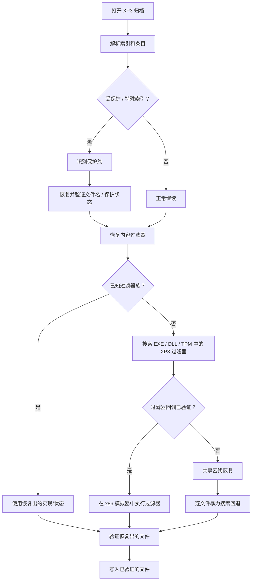
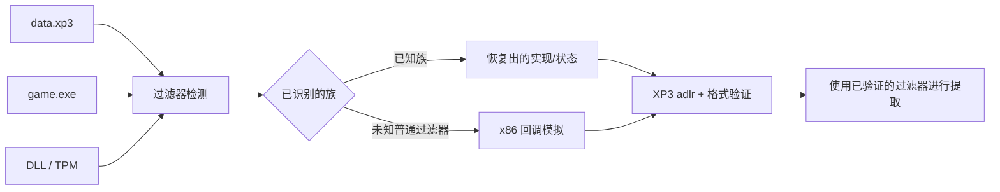
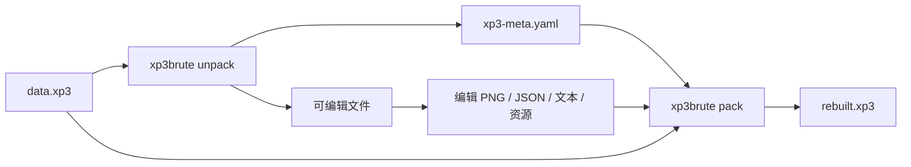

# xp3-brute

`xp3-brute` 是一个用于提取、恢复、转换和重新构建 KiriKiri XP3 归档的跨平台工具。它可以自动检测解包受保护归档所需的全部信息。

```bash
xp3brute unpack data.xp3 out
```

工具会检查归档并将文件写入 `out/`。

`unpack` 会刻意保持普通控制台视图简洁：它输出稳定的 `status phase=...` 进度记录，最后输出一个 `summary`。交互式终端视图会将这些状态显示为单个进度条。需要每次探测的恢复证据时使用 `--verbose`；需要更安静、适合嵌入的调用时使用 `--no-progress`。

核心思路：这一次我们不依赖运行时来提取归档。
- 对于复杂的 CXDEC 变体，工具可以恢复关键参数。
- 对于简单的 KiriKiri 加密过滤器，工具可以在 x86 模拟器中定位并执行游戏真正的提取逻辑。
- 只有前面的方法失败时才使用暴力搜索。暴力恢复支持 CPU 主机和 GPU 加速。

---

## 快速开始

### 工作区结构

此仓库是一个 Cargo 工作区：

```text
xp3-brute/                 # 共享核心库和 xp3brute CLI
apps/xp3-desktop/          # 原生 eframe/egui 桌面应用
packages/python/           # 可发布的 PyPI SDK 和 wheel 元数据
```

CLI 仍然是默认工作区成员，因此现有的 `cargo build` 和 `cargo run -- ...` 工作流不变。使用以下命令构建桌面应用：

```bash
cargo build -p xp3-brute --bin xp3brute
cargo run -p xp3-brute-desktop --bin xp3brute-gui
```

桌面应用提供归档浏览、搜索、选中条目的原始导出、文件/文件夹选择器和异步完整解包视图。完整解包调用相同的 `xp3brute unpack` 流程，并将规范化状态输出流式写入操作日志。CLI 不在 `PATH` 中时，将 `XP3BRUTE_BIN` 设置为它的绝对路径。

### 构建

```bash
cargo build --release
```

可执行文件是：

```text
target/release/xp3brute
```

带标签的发行版也会发布预构建的 Linux x86_64、macOS arm64 和 Windows x86_64 二进制文件。包括 Linux glibc 兼容性基线在内的 CI 和发行策略请参阅 [`docs/CI.md`](docs/CI.md)。

也可以在不启用可选 GPU 后端的情况下进行 CPU-only 构建：

```bash
cargo build --release --no-default-features --features magic-sniff
```

### NixOS / Nix Flake

由 GPT-6 生成。

仓库包含一个 Flake，为 Linux 和 macOS 打包 `xp3brute` CLI。

在启用了 flakes 的 NixOS 安装中，从检出目录直接运行工具：

```bash
nix run . -- --help
nix run . -- unpack data.xp3 out
```

需要重复使用时，可以构建软件包或安装到当前用户的 profile：

```bash
nix build .#xp3brute
nix profile install .
xp3brute --help
```

开发时，Flake 提供包含 Rust、Cargo、CMake、Clang 及项目所需其他原生构建工具的 shell：

```bash
nix develop
cargo build --release
```

若要从独立的 NixOS 系统 Flake 使用此软件包，将本仓库添加为输入，并加入 `environment.systemPackages`：

```nix
{
  inputs.xp3-brute.url = "github:Waroku06/xp3-brute";

  outputs = { self, nixpkgs, xp3-brute, ... }:
    let
      system = "x86_64-linux";
    in {
      nixosConfigurations.my-host = nixpkgs.lib.nixosSystem {
        inherit system;
        modules = [{
          environment.systemPackages = [
            xp3-brute.packages.${system}.default
          ];
        }];
      };
    };
}
```

添加输入后，使用以下命令重建系统：

```bash
sudo nixos-rebuild switch --flake .#<hostname>
```

如果尚未启用 flakes，先将 `nix.settings.experimental-features = [ "nix-command" "flakes" ];` 加入 NixOS 配置。

### Python / CPython 绑定

可发布的 SDK 位于 [`packages/python`](packages/python)。它在原生 CPython 扩展之上提供 Python API，并支持归档检查/重建、PBD/TLG/AMV 转换、清单重建/打包、往返验证、过滤器检测和重复 XOR 恢复。

```bash
pip install xp3-brute
```

源码开发：

```bash
cd packages/python
python -m pip install 'maturin>=1.12,<2'
maturin develop --release
```

Wheel 以 CPython 稳定 ABI（Python 3.9+）为目标，并在 CI 中为 manylinux2014 x86_64、macOS arm64 和 Windows x86_64 构建。结构化报告以 JSON 字符串返回，可交给 `json.loads` 或直接记录日志。

```python
from xp3_brute import Xp3

archive = Xp3.open_archive("data.xp3")
print(Xp3.inspect("data.xp3"))
for entry in archive.entries():
    print(entry.index, entry.name, entry.original_size)

storage_bytes = archive.reconstruct_entry(0)
report = Xp3.detect_filter("game.exe")
print(report["backend"], report["confidence"])
```

发行版发布使用 PyPI trusted publishing 和 [`python-publish.yml`](.github/workflows/python-publish.yml) 中的 wheel 矩阵。Rust 使用者仍可直接使用相同的、与前端无关的公共 API。

---

## 解包 XP3 归档

```bash
xp3brute unpack data.xp3 out
```

如果游戏可执行文件不在 XP3 归档旁边，可以显式指定：

```bash
xp3brute unpack data.xp3 out --exe game.exe
```

`--exe` 可以指向游戏可执行文件。工具在寻找提取过滤器时，也可以检查附近的 DLL/TPM 模块。

### 自动执行的过程



暴力恢复是**最后的回退方式**。工具首先尝试识别并执行游戏实际使用的提取/过滤逻辑。

---

## 解包时转换游戏资源

默认情况下，恢复出的文件保持原始格式。

使用 `--unpacker-all` 启用可用的资源转换器：

```bash
xp3brute unpack data.xp3 out --unpacker-all
```

| 资源 | 默认行为 | 使用 `--unpacker-all` |
|---|---|---|
| 编译后的 TJS2（`.tjs`） | 保留字节码 | 高级反编译，使用相同的 `.tjs` 路径 |
| TLG5/TLG6 | 保留 TLG | 转换为 PNG |
| PSB / SCN / MTN / PIMG | 保留原格式 | JSON + 解码后的 PNG/资源 |
| PBD | 保留原格式 | 类型化 JSON |
| 支持的 AMV/AJPM | 保留原格式 | PNG 帧 |
| KiriKiri 封装文本 | 验证后解码 | 验证后解码 |

也可以显式选择单个解码器：

```bash
xp3brute unpack data.xp3 out --tjs decompile
xp3brute unpack data.xp3 out --tjs emit
xp3brute unpack data.xp3 out --tlg png
xp3brute unpack data.xp3 out --psb json
xp3brute unpack data.xp3 out --psb png
xp3brute unpack data.xp3 out --pbd json
xp3brute unpack data.xp3 out --amv png
```

显式选项会覆盖 `--unpacker-all` 预设。TJS2 转换不会改变文件名：`scenario.tjs` 仍然是 `scenario.tjs`。如果加载、输出或反编译失败，则保留原始 TJS2 字节。重新打包时，提取出的文本 `.tjs` 会被视为源文本并直接写回；`xp3brute` 不会尝试将其重新编译为 TJS2 字节码。

---

## 检查归档

```bash
xp3brute inspect data.xp3
```

只想检查 XP3 结构、条目或检测到的保护族，而不提取全部内容时使用此命令。

---

## 自动恢复提取过滤器

较老的 KiriKiri 游戏经常使用存放在游戏 EXE、DLL 或 `.tpm` 插件中的 XP3 提取过滤器保护文件内容。

`xp3-brute` 可以自动搜索这些模块，并根据真实 XP3 条目验证候选过滤器。



只有在恢复真实归档样本并通过可用的 XP3 `adlr` 和文件格式检查后，才会接受通用 x86 过滤器。

通常不需要手动使用过滤器诊断命令。

故障排查：

```bash
xp3brute filter-probe game.exe
xp3brute filter-probe plugin/filter.tpm --dynamic-v2link
```

---

## 受保护的归档

受保护的 XP3 变体会自动检测。

工具当前包含以下专门处理：

- 历史上的间接 Special-index 变体；
- 多个 CXDEC 代际；
- HXV4 认证的 Special 索引及其内容过滤器状态；
- 可以从 PE32/i386 模块中定位并执行的普通 KiriKiri 提取过滤器。

保护名称或四字节块标签不会被视为权威标识符。工具使用归档结构、可执行文件行为/状态以及针对真实 XP3 数据的验证。

对于正常使用，命令仍然是：

```bash
xp3brute unpack data.xp3 out
```

或者：

```bash
xp3brute unpack data.xp3 out --exe game.exe
```

---

## 重建 XP3 归档

解包时，`xp3-brute` 会写入：

```text
xp3-meta.yaml
```

此清单保存重建原始归档以及重新应用其过滤器/保护状态所需的元数据。

编辑提取出的资源后：

```bash
xp3brute pack out rebuilt.xp3
```

如果原始归档已不在解包时记录的路径：

```bash
xp3brute pack out rebuilt.xp3 --source-archive /path/to/data.xp3
```

默认写入器基于源模板。它会尝试保留原始 XP3 表示形式，而不是将归档重建为规范化布局。

原始 XP3 的 `adlr` 字节会被保留，绝不会重新计算。

### 重建流程



---

## 验证往返过程

```bash
xp3brute verify-roundtrip out \
  --source-archive data.xp3 \
  --output rebuilt.xp3
```

机器可读的报告：

```bash
xp3brute verify-roundtrip out \
  --source-archive data.xp3 \
  --output rebuilt.xp3 \
  --json
```

验证会将 XP3 容器与解码后的资源格式分开检查。

---

## 独立资源转换

### TLG

```bash
xp3brute decode-tlg image.tlg image.png
xp3brute decode-tlg image.tlg image.jpg --jpeg-quality 92
xp3brute decode-tlg image.tlg image.bmp
```

将图像编码为 TLG：

```bash
xp3brute encode-tlg image.png image.tlg
```

### PBD

```bash
xp3brute decode-pbd script.pbd script.pbd.json
xp3brute encode-pbd script.pbd.json rebuilt.pbd
```

### AMV/AJPM

```bash
xp3brute encode-amv frames/ movie.amv --fps 30 --quality 75
```

---

## GPU 加速

默认构建包含可选的 `wgpu` 计算后端。

使用以下命令检查可用的计算设备：

```bash
xp3brute devices
```

`unpack` 默认使用：

```text
--compute auto
```

其他模式：

```bash
xp3brute unpack data.xp3 out --compute cpu
xp3brute unpack data.xp3 out --compute gpu
xp3brute unpack data.xp3 out --compute hybrid
```

GPU 加速用于适合的恢复工作负载。归档解析、原生过滤器执行、解压和最终验证仍在 CPU 侧完成。

---

## 有用的诊断命令

这些命令主要用于不受支持的游戏或开发/调试：

```bash
# 探测归档恢复假设
xp3brute probe data.xp3 --max-period 1024 --top 8

# 测试多个文件是否共享重复密钥
xp3brute shared-probe data.xp3 --max-period 1024 --top 20

# 重建 XP3 存储流，但不应用特定游戏的过滤器
xp3brute extract-raw data.xp3 out/

# 检查历史 Special-index 数据
xp3brute scan-special data.xp3

# 分析可执行文件中的 HXV4 信息
xp3brute exe-analyze game.exe --archive data.xp3
```

大多数用户不需要这些命令。

---

## 支持范围

`xp3-brute` 当前覆盖以下主要领域：

- XP3 原始/zlib 索引解析和重建；
- standard / Krkr2 / KrkrZ 风格归档；
- 历史间接 Special-index 变体；
- CXDEC 族内容过滤器；
- 通用 PE32/i386 XP3 提取过滤器发现和模拟；
- HXV4 Special 和内容过滤器恢复；
- 作为最终回退方式的重复密钥恢复；
- TLG5/TLG6 解码和 TLG5 编码；
- PSB / SCN / MTN / PIMG 解析和资源提取；
- PBD 解码/编码；
- 支持的 AMV/AJPM 资源提取/重建；
- KiriKiri 文本封装和常见游戏资源格式；
- 基于源模板的 XP3 重新打包和往返验证。

并非所有厂商特定的保护都能自动恢复。未知过滤器或归档变体仍可能需要额外分析。

---

## 内存使用

`Archive::open` 使用文件后端；打开大型 XP3 不会将整个归档加载到 RAM。

解包器会以有界批次处理最终条目。在低内存环境中：

```bash
KRKR_UNPACK_BATCH_SIZE=1 xp3brute unpack data.xp3 out
```

也可以使用以下变量更改批次字节预算：

```text
KRKR_UNPACK_BATCH_BYTES
```

---

## 项目结构

此 crate 同时提供：

- `xp3_brute`：可复用的 Rust 库；
- `xp3brute`：命令行前端。

详细实现说明位于 `docs/` 下。本 README 专注于常规安装、提取、转换、重建和故障排查工作流。
